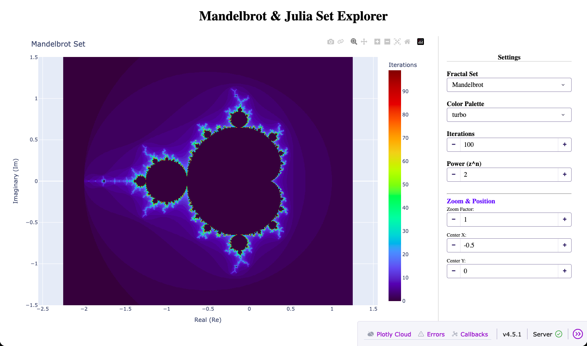

***
# 🌌 Mandelbrot & Julia Set Interactive Explorer

[](https://www.python.org/downloads/)  [](https://opensource.org/licenses/MIT)

A high-performance, single-page web application built with **Dash**, **Plotly**, and **NumPy**. This tool allows users to explore the infinite complexity of fractal geometry through interactive 2D visualizations, supporting both the Mandelbrot set and various Julia sets.




---
## ✨ Key Features

### 🚀 Interactive Exploration
* **Deep Zooming:** Use the mouse wheel to zoom in/out or use the manual zoom slider. The viewport automatically synchronizes with the center coordinates.
* **Intuitive Navigation:** Simply **click anywhere on the plot** to instantly re-center the view on that coordinate.
* **Dynamic Complexity:** Adjust the **Iteration Depth** in real-time to reveal finer details as you zoom deeper.
### 🎨 Customization & Math
* **Multibrot Support:** Change the power $n$ in the recurrence relation $z_{n+1} = z_n^p + c$ to explore higher-order fractals.
* **Color Exploration:** A wide array of professional Plotly color scales (from `viridis` to `magma` and `spectral`) to visualize escape-time intensity.
* **Julia Set Exploration:** Switch from the Mandelbrot "map" to specific Julia "landscapes" using predefined magic constants.
### 🛠️ Technical Robustness
* **Vectorized Engine:** Uses NumPy masking to calculate millions of points simultaneously without slow Python loops.
* **Automatic Port Management:** Features a built-in "Port Janitor" to automatically clear zombie processes on port `8050`, ensuring a smooth startup every time.
* **Responsive Design:** The layout adjusts to your screen size, providing a seamless experience on various desktop resolutions.

---

| Control | Behavior |
| :--- | :--- |
| **Fractal Set** | Toggles between the Mandelbrot map and specific Julia sets. |
| **Color Palette** | Changes the visual representation of escape-time iterations. |
| **Iterations** | Sets the depth of calculation (higher = more detail, slower). |
| **Power ($z^n$)** | Adjusts the degree of the polynomial. |
| **Zoom Factor** | Magnifies the viewport around the current center. |
| **Center X/Y** | Precisely sets the mathematical coordinate at the viewport center. |

---
## 📐 Mathematical Overview

The application explores the behavior of the complex quadratic recurrence relation:
$$z_{n+1} = z_n^p + c$$
### Mandelbrot vs. Julia Sets
The relationship between these two sets is the core of fractal geometry. The Mandelbrot set acts as a **Parameter Map**, while Julia sets are the **Dynamical Landscapes** defined by specific values from that map.

| Feature | Mandelbrot Set | Julia Set |
| :--- | :---: | :---: |
| **What varies?** | The constant $c$ (the rule) | The starting value $z$ (the position) |
| **What is constant?** | The starting value $z$ (always $0$) | The constant $c$ (fixed for that set) |
| **Purpose** | To show which rules are "stable" | To show patterns created by one rule |
| **Visual Result** | A single, universal "map" | Infinite possible different "patterns" |

**Constants for Julia Sets:**
* **Classic Beauty:** $c = -0.4 + 0.6i$
* **Douady Rabbit:** $c = -0.123 + 0.745i$
* **Dendrite:** $c = 0 + 1.0i$
* **San Marco:** $c = -0.75 + 0.1i$

---
## 🚀 Installation & Usage

### Requirements
* Python 3.8+
* NumPy
* Plotly
* Dash

### Quick Start

1. **Install dependencies:**
   ```bash
   python -m pip install numpy plotly dash
   ```

2. **Run the app:**
   ```bash
   python plotlyv2.py
   ```

3. **View the explorer:**
   Open your browser and navigate to: [http://127.0.0.1:8050/](http://127.0.0.1:8050/)

---
*Developed with ❤️ using Python3, NumPy, and Plotly.*